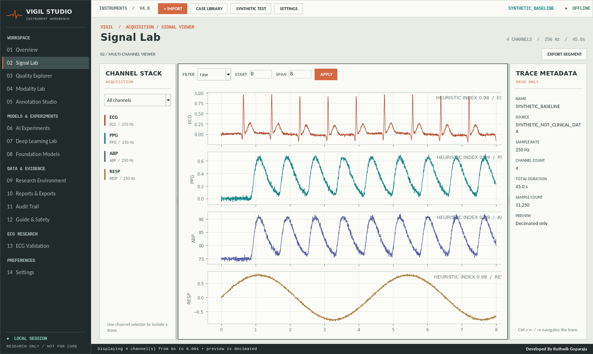
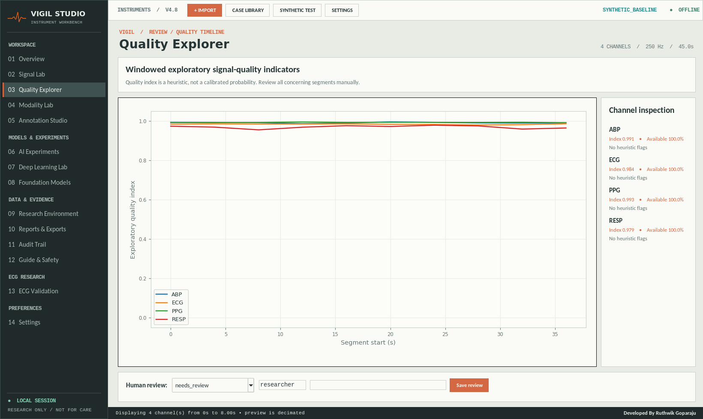
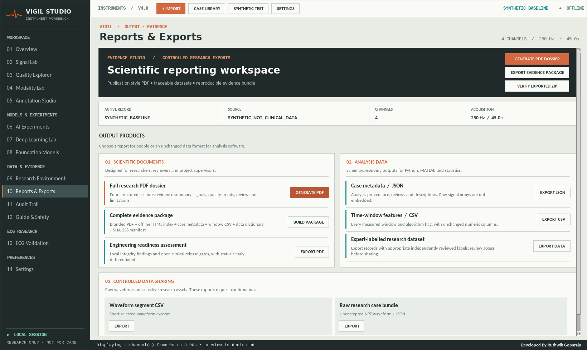

# VIGIL Studio v4.8

**Biomedical Signal Analysis & AI Research Workstation**  
Developed by **Ruthwik Goparaju**

> **Research and engineering use only.** VIGIL Studio is **not clinically validated or authorized** for patient diagnosis, bedside monitoring, clinical alarm control, or treatment decisions.

VIGIL Studio is a Windows-oriented Python desktop workstation for exploring biomedical waveform data, inspecting signal quality, annotating intervals, evaluating ECG detectors against published reference annotations, training experimental models, and producing scientific evidence reports.

## Capabilities

- ECG, EEG, EMG, PPG, arterial blood-pressure and respiratory waveform viewers
- Exploratory signal-quality and artifact analysis; time and frequency-domain descriptors
- Native WFDB / MIT-BIH research workflows, expert-reference overlays, and detector timing evaluation
- Human interval annotations, SQLite research case library and local evidence/audit tools
- Classical ML, PyTorch research experiments and optional time-series foundation model interfaces
- Synthetic test fixtures, dataset source metadata, research reporting and reproducibility tools
- Windows launcher and optional executable build scripts
- Adjustable sidebar text size and project-specific workstation branding

## Screenshots

| Signal Lab | Quality Explorer | Reports & Exports |
|---|---|---|
|  |  |  |

More **actual application screenshots** are in [`media/screenshots`](media/screenshots).

## Showcase media

Screenshots are available in [`media/screenshots`](media/screenshots), and synthetic example reports are under [`examples`](examples). The optional 15 MB LinkedIn showcase archive is not committed to the source-only repository.

## Quick start (Windows)

1. Install **Python 3.12 (64-bit)** and Git if needed.
2. Clone this repository and open its folder.
3. Double-click `START_WINDOWS.bat` (first run installs dependencies).
4. For isolated synthetic demonstrations, run `START_SHOWCASE_WINDOWS.bat`.
5. Run `RUN_SELF_TEST_WINDOWS.bat` to check the installation.

The optional foundation model and published biomedical datasets are **not bundled** and require separate official-source downloads. Review the publisher's license before downloading.

## Verification evidence

The v4.8 development package reports **126 / 126 automated software tests passed** on Python 3.13.5 / Linux, plus GUI smoke tests. See [`TEST_RESULTS.md`](TEST_RESULTS.md) for exact test scope and important limitations. These are **software engineering tests, not 100% clinical accuracy**. The full MIT-BIH clinical-performance benchmark and hospital validation remain open.

## Real ECG research

The MIT-BIH Arrhythmia Database is available from [PhysioNet](https://physionet.org/content/mitdb/1.0.0/). Real patient-data files and checkpoint weights are not committed to this repository. The sample CSVs under `examples/` are synthetic and labelled as such.

## Security and clinical limitations

Do not put identifiable patient data, hospital credentials, or production encryption keys in this repository or use this build for active patient care. The research storage is not a protected hospital EHR. Security controls and standards-oriented documentation are experimental and are **not a compliance certificate**.

Read [`docs/READ_ME_FIRST_HOSPITAL_PROJECT.md`](docs/READ_ME_FIRST_HOSPITAL_PROJECT.md), [`docs/KNOWN_LIMITATIONS.md`](docs/KNOWN_LIMITATIONS.md), and [`docs/PROFESSIONAL_REPORTING_V4_8.md`](docs/PROFESSIONAL_REPORTING_V4_8.md).

## License and credits

Source release includes the project `LICENSE` (MIT); third-party datasets, pretrained models, screenshots and dependencies may have separate license and attribution requirements. Confirm the right to publish commissioned work before using this repository for hospital deployment.

**Developer:** Ruthwik Goparaju.  
**Release:** VIGIL Studio v4.8 · research-only.
